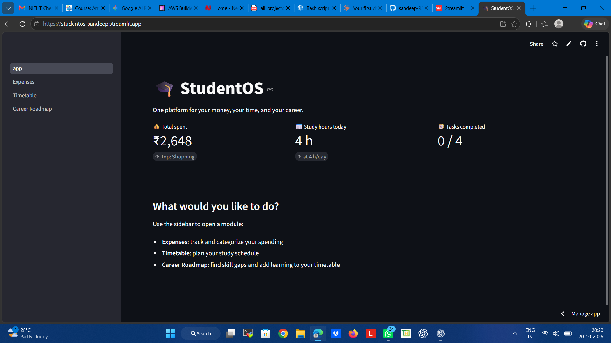
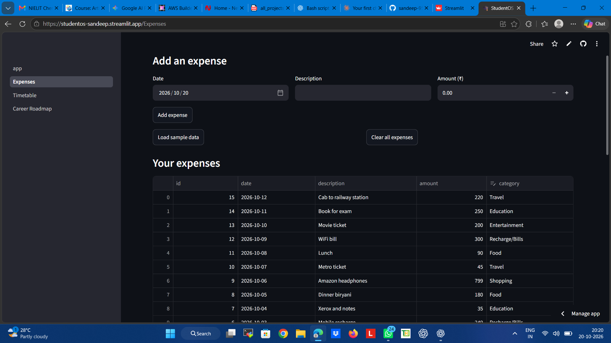
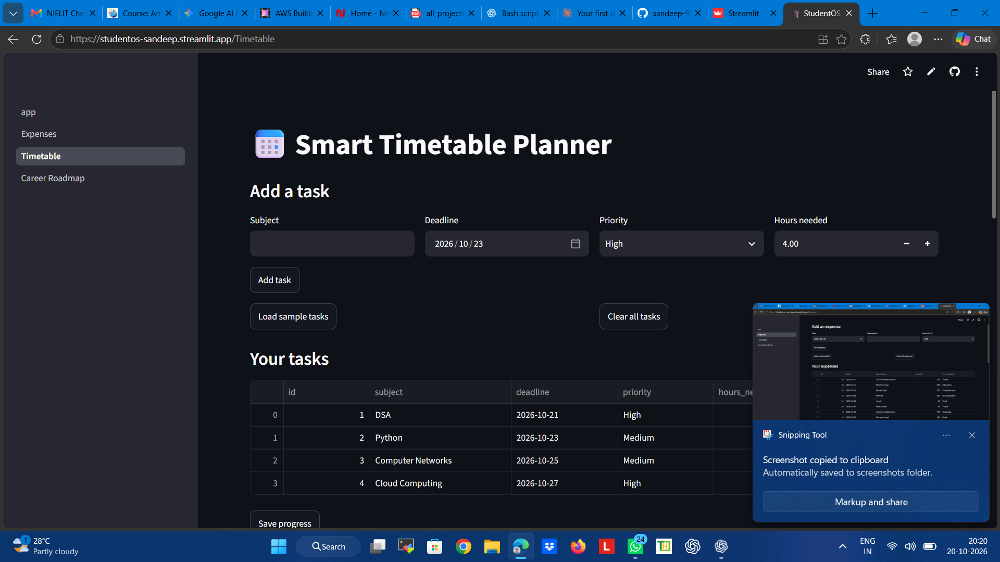
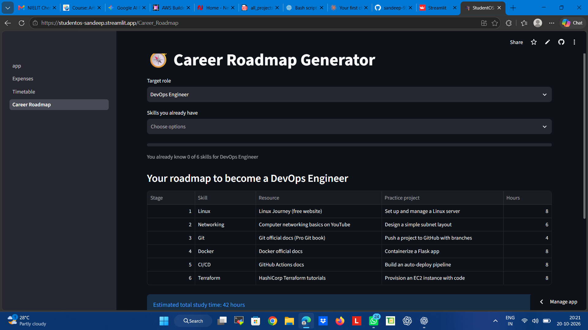

# 🎓 StudentOS – AI-Powered Student Life Assistant

StudentOS is an all-in-one productivity web application designed to help college students manage daily expenses, schedule study time around deadlines, and build step-by-step career roadmaps.

## Live Demo

Try the live application here:  
https://studentos-sandeep.streamlit.app/

## Problem Statement

College students face three common challenges every semester:
1. **Uncontrolled spending**: It is difficult to track small daily purchases (food, travel, printouts, recharges) and stay within a monthly allowance.
2. **Poor study planning**: When multiple assignments and exams pile up, students struggle to calculate how many hours to study each day and often miss deadlines.
3. **Unclear career paths**: Students want to prepare for industry roles (like DevOps, Data Analyst, or Cloud Engineer) but do not know which specific skills they lack, where to study them, or what projects to build.

StudentOS brings solutions to all three problems into a single dashboard.

## Features

### 1. Expense Organizer
- **Keyword-based categorization**: Automatically categorizes transactions into Food, Travel, Shopping, Recharge/Bills, Education, or Entertainment based on words in the description. Anything else goes to Others.
- **Editable categories**: An interactive data table allows students to change any category directly in the browser and save updates to the database.
- **Visual charts**: Interactive Plotly pie chart and bar chart show spending breakdown by category.
- **Spending insight**: Highlights the top spending category and shows what percentage of total money went into it.
- **Monthly budget alert**: Set a target monthly budget and watch the progress bar. The app displays real-time status messages: within budget, warning when passing 80% usage, and alert when over budget.
- **Sample data & reset**: One-click button to load sample student expenses or clear records.

### 2. Smart Timetable Planner
- **Priority and deadline scheduling**: Generates a day-by-day study calendar based on task deadlines, estimated hours needed, and task priority (High, Medium, Low).
- **Time shortage warnings**: Automatically alerts students if a deadline has already passed or if there are not enough days left to complete the required study hours.
- **Task progress tracking**: Mark tasks as completed using checkboxes. A visual progress bar displays the overall completion rate.
- **Daily plan & overview**: Displays what needs to be studied today, an editable full timetable view, and a bar chart of daily study hours.
- **Sample tasks**: One-click button to load sample academic subjects or reset tasks.

### 3. Career Roadmap Generator
- **Skill-gap analysis for 5 roles**: Supports DevOps Engineer, Data Analyst, Full Stack Developer, AI/ML Engineer, and Cloud Engineer.
- **Personalized roadmap**: Select the skills you already know. The app compares them with the target role and generates a customized list of missing skills.
- **Curated resources & projects**: Each missing skill includes recommended free learning resources, a hands-on practice project, and estimated study hours.
- **Readiness score**: Progress bar shows the percentage of role requirements you already meet.

### 4. Integration
- **One-click transfer to timetable**: With one click on "Add roadmap to my timetable", all missing career skills are automatically converted into study tasks with spaced deadlines and saved to the database.
- **Shared SQLite database**: The dashboard, expense tracker, timetable, and career roadmap share the same database (`studentos.db`), keeping progress synchronized across the app.

## How It Works

### Expense Categorization Logic (`core/categorizer.py`)
The categorizer uses simple keyword matching:
1. The description text is converted to lowercase.
2. The function checks against a predefined dictionary of keyword lists:
   - **Food**: breakfast, lunch, dinner, tea, snack, canteen, biryani
   - **Travel**: bus, auto, metro, petrol, train, cab, railway
   - **Shopping**: amazon, flipkart, clothes, shoes, headphones
   - **Recharge/Bills**: recharge, wifi, bill
   - **Education**: book, xerox, fees, course, notes
   - **Entertainment**: movie, game, netflix
3. If any keyword matches a word in the description, that category is assigned. If no keywords match, it defaults to "Others".

### Smart Scheduling Algorithm (`core/scheduler.py`)
The scheduler calculates how to fit all pending tasks into daily study routines:
1. **Priority weights**: Tasks are assigned numerical weights based on priority:
   - High = 3
   - Medium = 2
   - Low = 1
2. **Urgency scoring**: For each day from today until the latest deadline, active tasks are ranked using an urgency score:
   $$\text{Score} = \frac{\text{Priority Weight}}{\max(\text{Days Until Deadline}, 1)}$$
   Tasks with higher priority and closer deadlines are scheduled first.
3. **Block allocation**: Study time is allocated in chunks of up to 2 hours per session, subject to the student's daily available study limit.
4. **Deficit detection**: If all available study hours before a deadline are filled and hours still remain unfinished, the task is marked as unscheduled and a warning is displayed.

### Skill-Gap Analysis Logic (`core/roadmap.py`)
The roadmap generator calculates what a student still needs to learn:
1. Role requirements are loaded from `data/roles.json`.
2. The user's selected skills are converted into a normalized lowercase set (`have`).
3. The function splits the curriculum into two lists:
   - **Missing skills**: skills whose names are not found in `have`.
   - **Known skills**: skills whose names match an entry in `have`.
4. Missing skills are presented sequentially with free resources and practice projects. When exported to the timetable, deadlines are automatically staged forward based on user-chosen study days per skill.

## Tech Stack

- **Python**: Core programming language
- **Streamlit**: Multi-page web framework for UI and user interaction
- **pandas**: Data manipulation, aggregation, and tabular operations
- **Plotly**: Interactive data visualizations (pie charts and bar charts)
- **SQLite**: Lightweight local relational database for persistent storage

## Project Structure

```text
StudentsOs/
├── app.py                     # Main dashboard with overview metrics
├── core/
│   ├── __init__.py
│   ├── categorizer.py         # Keyword matching logic for expenses
│   ├── db.py                  # SQLite database connection and schema setup
│   ├── roadmap.py             # Skill-gap analysis and role data loading
│   └── scheduler.py           # Priority and deadline-based scheduling algorithm
├── data/
│   ├── roles.json             # Curated skills, resources, and projects for 5 roles
│   └── sample_expenses.csv    # Sample expense dataset for testing
├── pages/
│   ├── 1_Expenses.py          # Expense tracking, budget alerts, and charts
│   ├── 2_Timetable.py         # Study timetable planner and task tracking
│   └── 3_Career_Roadmap.py    # Career roadmaps and timetable integration
├── screenshots/
│   ├── home.png               # Screenshot of home dashboard
│   ├── expenses.png           # Screenshot of Expense Organizer
│   ├── timetable.png          # Screenshot of Smart Timetable Planner
│   └── roadmap.png            # Screenshot of Career Roadmap Generator
├── requirements.txt           # Python package dependencies
└── Readme.md                  # Project documentation
```

## How to Run Locally

### Prerequisites
Make sure Python 3.9 or higher is installed on your computer.

### Installation Steps

1. Clone or download this repository to your computer.
2. Open a terminal or command prompt inside the project folder:
   ```bash
   cd StudentsOs
   ```
3. Install the required Python packages:
   ```bash
   pip install -r requirements.txt
   ```
4. Start the Streamlit application:
   ```bash
   python -m streamlit run app.py
   ```
5. Open your web browser at the URL shown in your terminal (usually `http://localhost:8501`).

## Limitations

- **Ephemeral cloud database**: On free cloud hosting (like Streamlit Community Cloud), the local SQLite database resets whenever the server restarts or goes to sleep.
- **Rule-based categorization**: Expense categorization uses basic keyword matching instead of natural language understanding, so unfamiliar words fall back to "Others".
- **No user authentication**: The app currently does not have login or user accounts. All data is saved to a single shared local database.

## Future Scope

- **User authentication**: Support user signup and login so multiple students can maintain private accounts.
- **AI-powered summaries**: Integrate Large Language Models (LLMs) to provide weekly financial insights and personalized study advice.
- **CSV and statement import**: Allow students to upload bank or UPI transaction CSV files directly.
- **Expanded career roles**: Add more technology domains such as Cybersecurity, Mobile App Development, UI/UX Design, and Blockchain.

## Author

**Sandeep**  
Aditya Engineering College

## Screenshots








